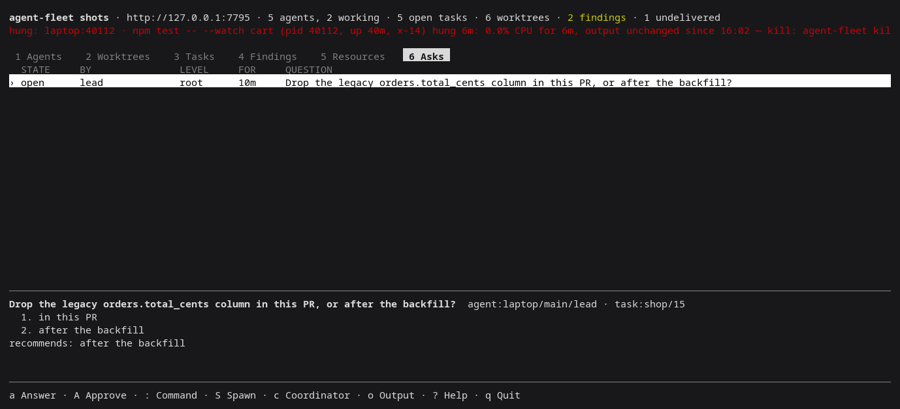
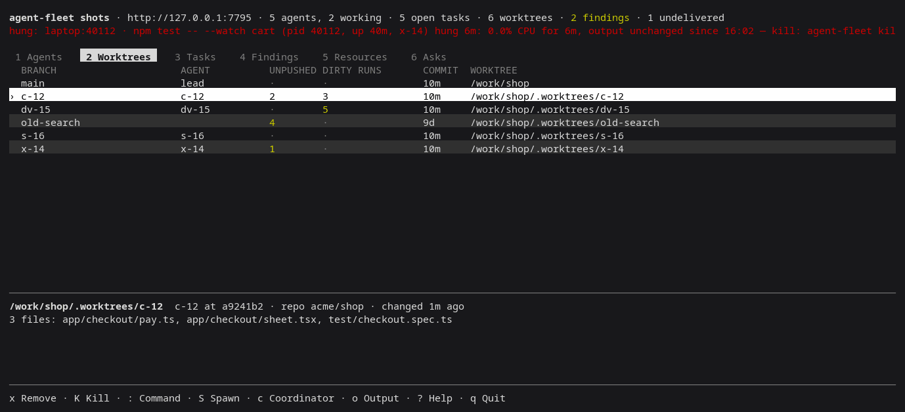
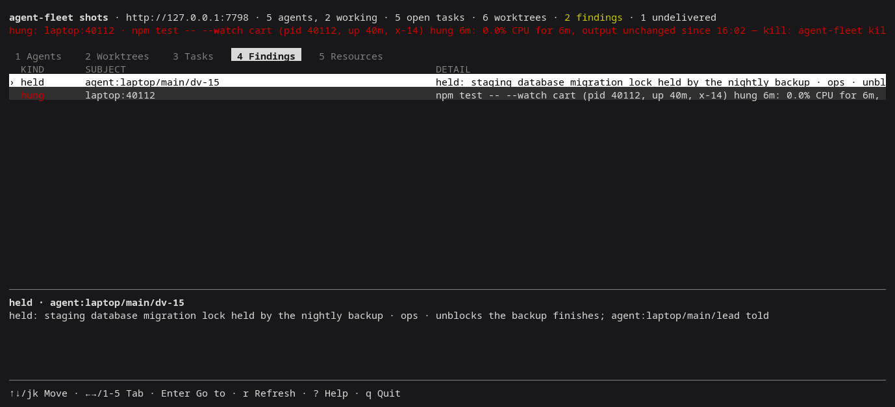

# agent-fleet

agent-fleet helps you run several AI coding agents at the same time. The agents (Claude Code,
Codex, Devin CLI and others) run in [herdr](https://herdr.dev) terminal panes, on one machine or a
few. With five or ten of them at work, it is hard to keep track: which agent works on which
issue, which one has stopped and why, whether two of them do the same work, and what they left
behind. agent-fleet keeps that record for you and acts on it:

- It starts an agent on a GitHub issue, in its own git worktree, with a brief.
- It shows what every agent is doing: working, idle or blocked, on which task and branch.
- It gives each task one owner, so two agents do not take the same issue.
- It delivers messages to agents and records that they arrived.
- It finds stuck agents, hung or orphaned processes, and forgotten worktrees, and tells you or
  the agent that coordinates the others.

It is for a developer who runs a fleet of coding agents on their own GitHub repositories. One
Rust binary, no runtime. Linux and macOS.

## What using it looks like

Connect a repository once, then start an agent on an issue. The agent gets a worktree, a herdr
pane, a brief and the issue as its task:

```sh
agent-fleet repo add owner/repo
agent-fleet spawn owner/repo#123       # prints: agent:<host>/<session>/<name> is up (pane …, <worktree>)
```

To run an agent in the repository's own checkout, with a brief you wrote (a release agent, say),
add `--in-place --brief <file>`: no worktree is made, and `retire` closes the pane and leaves the
checkout alone.

Start more, then see the fleet:

```sh
agent-fleet ps                         # every agent: working, idle or blocked, and for how long
agent-fleet tui                        # one screen: agents, worktrees, tasks, findings, questions
agent-fleet doctor                     # what needs a look: stuck or hung agents, duplicate work,
                                       # forgotten worktrees, unpushed commits
```

When an agent stops on something it cannot clear itself (a question, a full context, an error,
an empty quota), agent-fleet reads its screen, names the cause and sends a message to the agent's
lead, or to the agent you made coordinator. agent-fleet types each message into the recipient's
prompt (a "doorbell"), for example:

```
[agent-fleet host:laptop→lead] QUESTION c-123: c-123: Keep the old API or remove it? (event …)
```

A hung or orphaned process gets the same kind of message (`HUNG`, `ORPHAN`), with the
`agent-fleet kill` command that stops it safely. You answer agents, send them work and finish
tasks from the CLI, the TUI or the browser board (`agent-fleet ui`):

```sh
agent-fleet tell c-123 FYI owner/repo#123 "keep the old API"
agent-fleet task done task:repo/123
```

Agents run the same commands themselves: they claim tasks, raise blockers, ask you questions
and message each other.

**Status:** early (0.1.0). It runs a real fleet every day, but the CLI, the config and the
protocol can still change without notice.

## Prerequisites

- **Rust** (stable, with `cargo`) to build. A host that runs `self-update` needs `cargo` too.
- **[herdr](https://herdr.dev)**: the agents run in its panes, and the host reads presence from it.
- **git**: worktrees for spawned agents, `self-update`.
- **[gh](https://cli.github.com)**, signed in: `agent-fleet spawn` reads issues with it, and
  `doctor` uses it to find open PRs no agent owns.
- **lsof**: the host's watch tick uses it to tell hung processes from busy ones.

## Install

Build from a clone and install the binary. `self-update` later pulls `main` in this same clone
and rebuilds, so keep the clone on `main`.

```sh
git clone https://github.com/kirmalyshev/agent-fleet
cd agent-fleet
cargo install --locked --path .        # puts agent-fleet in ~/.cargo/bin
agent-fleet --version                  # the crate version and the commit it was built from
agent-fleet init
```

`agent-fleet init` writes this machine's `fleet.toml`, `brief.md` and `coordinator.md` into the user config dir
(`~/.config/agent-fleet` on Linux, `instances/<name>` under it for an instance other than
`default`; `AGENT_FLEET_CONFIG_DIR` overrides it). They are the rules
`spawn` uses for every repository: a profile for each agent program found on `PATH` (claude,
codex, devin, agy), one default rule, and a comment on every key. It never overwrites a file. It also
lists your Claude and Codex skills that drive terminals (herdr, tmux, cmux): in a fleet, agents
talk through `agent-fleet tell` and `spawn`, so check that those skills do not tell them to type
into each other's panes. Edit the two files, then start the hub and the host as in the quick
start below.

## Quick start

On one machine, with herdr running:

```sh
agent-fleet hub &                      # first start writes a token file and the hub's URL
herdr session list                     # the name and socket of your herdr session
agent-fleet host --herdr-socket <socket> --session <name> &
```

Inside a herdr pane, `HERDR_SOCKET_PATH` and `HERDR_SESSION` are set, so there `agent-fleet host`
needs no flags. Now start an agent in a herdr pane (for example `claude`). The host reports it:

```sh
agent-fleet ps                         # agent:<host>/<session>/<agent name>  idle  claude …
```

An agent in a herdr pane runs the CLI as itself: its id is derived from herdr. Outside an agent
pane, say who you are with `--as` or `AGENT_FLEET_AGENT`:

```sh
export AGENT_FLEET_AGENT=agent:laptop/main/me
agent-fleet task add build-cache --title "Cache the build"     # claim; 409 if someone holds it
agent-fleet tell <agent> REVIEW task:default/build-cache "ready for a look"
agent-fleet ui --text                  # agents, tasks, blockers, asks, undelivered doorbells, hosts
agent-fleet ui                         # the same board in the browser, live
```

`tell` refuses an agent that is not up: nothing would deliver the message. When the hub is down,
ordinary writes go to a local spool and replay later; `task add` refuses instead, because only the
hub can decide who owns a task. Reads fall back to the host's replica.

To try it without touching a fleet you already run, give it its own data directory and port:

```sh
export AGENT_FLEET_HOME=$(mktemp -d) AGENT_FLEET_INSTANCE=try
agent-fleet hub --listen 127.0.0.1:7799 &       # later commands find this hub through AGENT_FLEET_HOME
```

An agent's CLI reads its pane shell's environment, not yours: export the same two variables in
that shell before you start the agent, or its commands go to your other fleet.

## Connect a repository

```sh
cd <checkout of owner/repo>
agent-fleet repo add owner/repo        # or: agent-fleet repo add owner/repo <checkout>
agent-fleet repo ls
agent-fleet repo rm owner/repo
```

`repo add` records the checkout in the machine's `fleet.toml` (`[repos]`). It refuses a directory
that is not a git checkout and a checkout whose `origin` is another repository. The host re-reads
the list at each spawn and scan, so no restart is needed. It lists the repository's own terminal-driving
skills (`.claude/skills`, `.codex/skills`) the same way. A repository with its own
`.agent-fleet/fleet.toml` uses that file instead of the machine's rules. `repo add` also writes the
machine's `coordinator.md` if the config dir has none.

`agent-fleet host --repo owner/repo=<checkout>` flags still work and merge with this list.
Try a route without starting anything: `agent-fleet spawn owner/repo#123 --dry-run`. The
keys are explained in [docs/fleet.example.toml](docs/fleet.example.toml).

### Clean up worktrees

```sh
agent-fleet dev ls                        # every connected repo; --repo owner/repo for one
agent-fleet dev clean                     # what it would retire and delete (a dry run)
agent-fleet dev clean --execute
agent-fleet dev prune                     # free the slots of deleted worktrees
```

These cover the connected repositories, the checkouts the host reports, and the one you are in.
A local branch is finished when its tip is the head of one of your merged or closed PRs, is in the
default branch, or is in `origin/<branch>`. A branch with an open PR, or with commits nowhere else,
is never deleted. Only a finished PR retires a worktree, and never the main checkout, the one you
are in, a locked one, one an agent works in (by the fleet's log, the same rule as `doctor`'s
`forgotten`), or one with uncommitted files. Processes left in a worktree it retires are stopped
first (TERM, then KILL after 5 s); `ls` and the dry run list them, pid and command. A process an
agent program runs, a herdr pane and your own shell are never stopped: one of those in a worktree
keeps it; when the working directories of processes cannot be read (no `/proc`, no `lsof`), every
worktree is kept. It never unlocks a worktree: a lock whose pid is gone is called stale, with its
`git worktree unlock` command. `ls` also shows each worktree's dev slot, ports and running
services, and `clean` runs `dev down --release` for a worktree before it retires it. A worktree is
retired as the TUI's `x` does it:
`.agent-fleet/hook retire <path>`, else `git worktree remove`. `gh` (`AGENT_FLEET_GH`) reads the
PRs, one `gh pr list` per repository.

## Per-worktree dev environments

A repository with an `.agent-fleet/dev.toml` gets a dev environment per worktree: each worktree
has a slot with its own ports and values, its own services, and the shared infra.

```sh
agent-fleet dev up --api --web   # infra, then the services; waits for health, prints URLs
agent-fleet dev status           # running, healthy, env changed since start
agent-fleet dev logs api
agent-fleet dev down             # this worktree's services only; --release frees the slot
agent-fleet dev db reset         # the repo's [db] command; refuses a database another worktree uses
agent-fleet dev test unit -x     # the repo's [test.unit] with this worktree's env
agent-fleet dev agents           # the fleet's agents here: worktree, slot, PR and its health
agent-fleet dev prs              # your open PRs everywhere, their health and the agent on each
```

The file format, the commands and how slots are shared are in [docs/DEV.md](docs/DEV.md).

## Run the hub and host as services

`self-update` (and the host's own check every 5 minutes for a newer `origin/main`) rebuilds the
binary, and then the host **exits with status 75** so that its supervisor starts the new binary.
A host started by hand stays down after an update. The hub follows a replaced binary by itself
(same pid), so it needs a supervisor only to start at login and to recover from a crash.

**Linux, systemd `--user`.** `Restart=on-failure` restarts on any non-zero exit, 75 included.
Put both files in `~/.config/systemd/user/`. `%h` is your home directory; take the socket and
session from `herdr session list`.

```ini
# agent-fleet-hub.service
[Unit]
Description=agent-fleet hub

[Service]
ExecStart=%h/.cargo/bin/agent-fleet hub
Restart=on-failure
RestartSec=2

[Install]
WantedBy=default.target
```

```ini
# agent-fleet-host.service
[Unit]
Description=agent-fleet host
After=agent-fleet-hub.service

[Service]
ExecStart=%h/.cargo/bin/agent-fleet host --herdr-socket %h/.config/herdr/herdr.sock --session default
Restart=on-failure
RestartSec=2

[Install]
WantedBy=default.target
```

```sh
systemctl --user daemon-reload
systemctl --user enable --now agent-fleet-hub agent-fleet-host
loginctl enable-linger "$USER"         # keep them running when you are logged out
```

**macOS, launchd.** `KeepAlive` with `SuccessfulExit = false` restarts on a non-zero exit, 75
included. launchd does not expand `~` and its `PATH` is short, so give full paths and the `PATH`
that holds `cargo`, `git` and `gh`. Save as `~/Library/LaunchAgents/agent-fleet.host.plist`
(replace `/Users/you`, and take the socket and session from `herdr session list`), then `launchctl load ~/Library/LaunchAgents/agent-fleet.host.plist`. A hub
plist is the same with `hub` as the only argument and its own `Label`.

```xml
<?xml version="1.0" encoding="UTF-8"?>
<!DOCTYPE plist PUBLIC "-//Apple//DTD PLIST 1.0//EN" "http://www.apple.com/DTDs/PropertyList-1.0.dtd">
<plist version="1.0">
<dict>
  <key>Label</key>
  <string>agent-fleet.host</string>
  <key>ProgramArguments</key>
  <array>
    <string>/Users/you/.cargo/bin/agent-fleet</string>
    <string>host</string>
    <string>--herdr-socket</string>
    <string>/Users/you/.config/herdr/herdr.sock</string>
    <string>--session</string>
    <string>default</string>
  </array>
  <key>EnvironmentVariables</key>
  <dict>
    <key>PATH</key>
    <string>/Users/you/.cargo/bin:/opt/homebrew/bin:/usr/local/bin:/usr/bin:/bin:/usr/sbin:/sbin</string>
  </dict>
  <key>RunAtLoad</key>
  <true/>
  <key>KeepAlive</key>
  <dict>
    <key>SuccessfulExit</key>
    <false/>
  </dict>
  <key>StandardErrorPath</key>
  <string>/tmp/agent-fleet-host.log</string>
</dict>
</plist>
```

**No supervisor.** A shell loop restarts the host after an update and stops on any other exit:

```sh
while :; do agent-fleet host --herdr-socket <socket> --session <name>; [ $? = 75 ] || break; done
```

## Wire the agents

For Claude Code, add this to the project's `.claude/settings.json` (Devin CLI reads the same
file) or to `~/.claude/settings.json`:

```json
{
  "hooks": {
    "PreToolUse": [ { "matcher": "Bash|exec", "hooks": [ { "type": "command",
      "command": "command -v agent-fleet >/dev/null 2>&1 || exit 0; agent-fleet hook bash" } ] } ],
    "PostToolUse":      [ { "hooks": [ { "type": "command", "command": "agent-fleet hook mail || true" } ] },
                          { "hooks": [ { "type": "command", "command": "agent-fleet hook unread || true" } ] } ],
    "Stop":             [ { "hooks": [ { "type": "command", "command": "agent-fleet hook signal || true" } ] } ],
    "StopFailure":      [ { "hooks": [ { "type": "command", "command": "agent-fleet hook signal || true" } ] } ],
    "Notification":     [ { "hooks": [ { "type": "command", "command": "agent-fleet hook signal || true" } ] } ],
    "PreCompact":       [ { "hooks": [ { "type": "command", "command": "agent-fleet hook signal || true" } ] } ],
    "UserPromptSubmit": [ { "hooks": [ { "type": "command", "command": "agent-fleet hook signal || true" } ] } ]
  },
  "statusLine": { "type": "command", "command": "agent-fleet hook statusline" }
}
```

- `hook bash` refuses a raw `kill`, `pkill` or `killall` (use `agent-fleet kill`, which will not
  kill another agent's work), an agent started outside herdr (use `agent-fleet spawn`) and a
  `herdr pane send-text|send-keys|run` or `herdr agent prompt|send-keys` into another agent's
  pane (use `agent-fleet tell`).
- `hook mail` hands a busy agent that takes no typed input (Devin CLI) the tells that arrived
  while it worked, at its next tool call.
- `hook unread` hands a Claude Code agent its unread tells at its next tool call, whatever the
  turn is doing, and marks them read (as `agent-fleet read` does), so a tell sent during a long
  turn is not left waiting for the turn to end. Silent with none, with the hub down, outside
  herdr, for subagents and for any other program. The host's typed doorbell still reaches the
  agent at the turn boundary; `agent-fleet read` then finds nothing. Devin CLI gets its tells by
  `hook mail`; Codex and Antigravity (`agy`) have no tool-call hook that adds context for the
  agent, so theirs arrive as before.
- `hook signal` reports rate limits, permission prompts, questions and turn ends as
  `agent.signal`, so `ps` and `doctor` can say why an agent is stuck.
- `hook statusline` records Claude's rate limits for the host to publish as the agent's quota.
  To keep your own status line, wrap it: `agent-fleet hook statusline -- <your command>`.

Tell the fleet who coordinates. A hub has one coordinator, over every connected repository.
`agent-fleet init` writes the generic coordinator agent (`agents/coordinator.md` in this repository)
as `coordinator.md` in the config dir; edit that copy to change it for the machine.
`agent-fleet coordinator` prints it followed by a "Connected repositories" section: for each
repository, the project rules to read first (`.agent-fleet/coordinator.md`
and `AGENTS.md`, whichever exist; a repository with none is listed as
having none). Project rules extend the generic agent and never replace it. Start the coordinator
with that prompt:

```sh
agent-fleet coordinator claude              # in this terminal
agent-fleet coordinator claude --pane <id>  # in a herdr pane at a shell prompt
```

Its first message has it run `agent-fleet role me root-coordinator`. With no connected repository
it still starts and tells you to `agent-fleet repo add`. Only `claude` takes a system prompt for now.

To have the hub run it for you, spawn it: `agent-fleet spawn owner/repo --title coordinator
--name coordinator --level root-coordinator`. A root-coordinator spawn gets this prompt as its
brief in place of `brief.md`, and the level declares its role. This repository also ships the
agent for other harnesses as `.agents/coordinator.md` and `.claude/agents/coordinator.md`, both
links to `agents/coordinator.md`.

`agent-fleet tell coordinator …` then reaches it, and the host tells it about hung and orphaned
processes.
Other levels are `domain-lead`, `implementation-lead` and `implementer`, each with a `--lead`.

## Watch and steer the fleet: `agent-fleet tui`

`agent-fleet tui` shows the whole fleet on one screen and refreshes every 2 s. The top lines
count agents, tasks, worktrees, findings and undelivered messages; below them, in red, up to
three hung or orphaned processes, duplicate work or capacity breaches. Pick a tab with `1`–`6` or
`←`/`→`, move with `↑`/`↓` or `j`/`k`, and read the selected row's details in the bottom panel.
The footer lists the keys of the current tab; `?` shows them all, `q` quits.

`agent-fleet tui --all` watches every instance on this machine (`agent-fleet instances`). The
lines under the title name each one with its agents, working agents and findings, `replica` when
its hub is down and its replica stands in, or `no state`; the one on screen is highlighted, and
`[` and `]` switch it. The tabs show the instance on screen, and every action and command goes to
it: its prompt starts with the instance's name. A hub that is slow or down holds up none of the
others.


| Tab | Shows | Keys |
|---|---|---|
| 1 Agents | State, time in it, role, CPU, memory, task, branch | `t` send a message (`tell`), `f` focus its herdr pane, `R` set or clear its role, `H` hand it off (`handoff --to`) |
| 2 Worktrees | Branch, agent, unpushed commits, uncommitted files, what runs in it | `x` remove a worktree no agent works in, `K` kill the processes left in it |
| 3 Tasks | State, time in it, owner, open blockers, title | `n` new (`task add`), `a` assign, `d` done, `u` release, `x` cancel, `b` block, `B` unblock, `p` / `P` add / remove a dependency |
| 4 Findings | What `doctor` found: hung, orphaned, stuck or blocked work, and what `proc` says of each process | `Enter` go to the agent, worktree or resource, `K` kill a hung or orphaned process (`kill`, with its own checks) |
| 5 Resources | Locks the hosts report, who holds and who waits, capacity rules, quotas | `L` add a capacity rule, `U` remove the selected one |
| 6 Asks | The board's Inbox: questions from leads and the coordinator, open first, with their options | `a` answer, `A` approve |
| Everywhere | | `:` run any CLI command (Tab completes), `S` spawn, `c` tell the coordinator, `o` the last command's output |

`:` runs the CLI itself, with the screen's flags, so every action writes the same events as the
CLI, with the same checks and refusals. A command that only reads (`stats`, `doctor`, `proc`,
`ui` …) runs at once; every other asks first, and `spawn` shows its dry run first. The keys fill
the command line from the selected row, for you to finish and run.








`agent-fleet ui` opens the same fleet in the browser: a tree of repositories, worktrees, agents
and tasks, and the Inbox where you answer agents' questions.

## Configuration

Flags or environment:

| Variable | Flag | What |
|---|---|---|
| `AGENT_FLEET_INSTANCE` | `--instance` | Which fleet (default: in a herdr pane, the instance named after the session if it has a `hub` file; else `default`). |
| `AGENT_FLEET_HUB` | `--hub` | The hub's URL (default: the one this instance's hub wrote, else `http://127.0.0.1:7710`). |
| `AGENT_FLEET_HOME` | | The instance's data directory: hub log, token, spool, replica. |
| `AGENT_FLEET_TOKEN_FILE` | `--token-file` | The bearer token (default `<data dir>/token`). |
| `AGENT_FLEET_AGENT` | `--as` | Who is writing, `agent:<host>/<session>/<name>`. Derived inside an agent's herdr pane. |
| `AGENT_FLEET_PROJECT` | `--project` | Project for events that name none (default `default`). |
| `AGENT_FLEET_HOST` | `--host-name` | This machine's name in ids (default the hostname). |
| `AGENT_FLEET_CONFIG_DIR` | | Where the instance's `fleet.toml` and `brief.md` live. |
| `AGENT_FLEET_GH` | | The `gh` binary to run. |
| `AGENT_FLEET_DEV_SHARED` | | Where `dev` publishes each user's slots (default `/var/tmp/agent-fleet-dev`). |

The default data directory is the platform's (`~/.local/share/agent-fleet` on Linux).

**Instances.** One machine can run several fleets, one per project or product. Each instance has
its own directory (`instances/<name>` under the data directory), so its own hub, log, token,
spool and replica, and its own `fleet.toml` and connected repos (`instances/<name>` under the
config directory). Two hubs on one machine need two `--listen` ports. A host serves one instance
and one herdr session. In a herdr pane, commands default to the instance named after the session
once it has a `hub` file. For an instance whose hub is on another machine, write that file by
hand: one line, the hub's URL. `agent-fleet instances` lists them, and `agent-fleet tui --all`
shows them all on one screen.

**Several machines.** Run one hub. Bind it to an address the other machines reach, plus
loopback (`--listen 127.0.0.1:7710 --listen <address>:7710`); it refuses `0.0.0.0`. On each other
machine run a host with `AGENT_FLEET_HUB=http://<address>:7710` and a token file: a copy of the
shared token, or better a token minted for that host (see [SECURITY.md](SECURITY.md)).

## How it works

agent-fleet is one event log. Every fact (an agent came up, a task was claimed, a blocker was
raised, a message was delivered) is a typed event. The state is computed from the events in order
(a fold), and every view (`ps`, `tui`, `ui`) is read off that state.

```
   agents ── fleet CLI ──┐                       ┌── agent-fleet host (machine A) ── herdr ── agent panes
                         ▼                       │
                 agent-fleet hub: event log ── SSE ────┼── agent-fleet host (machine B) ── herdr ── agent panes
                 (SQLite) + state                │
                                                 └── …
```

1. **Everything is an event.** An agent runs `agent-fleet task add`, `agent-fleet block` or `agent-fleet tell`. Each
   command sends one small JSON event to the hub, for example `blocker.raised`.
2. **The hub keeps the log.** It checks each event, appends it to a SQLite log, and folds the log
   into one state: who is up, who owns which task, what is blocked, which messages are not yet
   delivered. `agent-fleet ps` and `agent-fleet ui --text` print that state.
3. **One host agent per machine (and herdr session) watches herdr.** herdr pushes a status change when an agent turns
   idle, working or blocked. `agent-fleet host` turns each change into an event, so the hub always knows
   what every agent is doing, with no polling.
4. **Messages are doorbells.** `agent-fleet tell` writes a `msg.sent` event. The host agent on the
   recipient's machine types it into that agent's prompt. When it sees the agent start working,
   it writes `msg.delivered`. A message with no `delivered` is visibly lost, and the host retries
   it.
5. **Only one thing needs the hub's permission.** Claiming a task is exclusive: if someone already
   holds it, the hub answers 409. Everything else can wait. When the hub is down, the CLI keeps
   writes in a local spool and sends them later; replaying is safe because every event has a
   unique id.
6. **Every machine has a copy.** The host agent copies the whole log locally. When the hub is
   down, reads still work from that copy.

## How a task is routed

`agent-fleet spawn owner/repo#123` picks the profile and host from the rules in `fleet.toml`
(the machine's file, or the repository's own `.agent-fleet/fleet.toml`, read from the base
branch, so a PR cannot change the rules that route it).

```
 issue ──▶ rules, first match wins ──▶ profile (+ host) ──▶ agent in its own worktree
                                          │
                                          └─ at its cap or out of quota at spawn time
                                             ──▶ the profile's `fallback`
```

- A rule's `match` words are compared with the issue's title and labels (`label:x` matches only a label named `x`);
  `--scope` narrows the work and never picks the worker. A rule
  with no `match` is the default and comes last. A rule's `host` says where the agent runs, for
  work that needs a particular machine (a simulator, say).
- A profile is one agent program with its arguments, prefix and `cap` (live agents per
  repository). Two profiles can run the same program with different models, such as `claude`
  with `--model opus`.
- `profile` may be a list: the spawn takes the least-loaded profile that has a seat and quota,
  and list order breaks ties.
- A profile that no rule names is only started by hand: `agent-fleet spawn … --profile codex`.
- `--dry-run` shows the choice and why, without starting anything. `agent-fleet stats` shows how
  each profile has done, from the events the hub already logs: speed, quality, predictability.

## The life of a task

1. **Issue.** One issue, one branch, one pull request.
2. **Spawn.** The host makes a worktree and a branch for the agent, runs the `ready` hook,
   starts the program in a herdr pane and types the brief into it.
3. **Work.** The agent reports through the CLI (`tell`, `block`, `ask`); the host reports what
   it sees in the pane.
4. **Pull request and verdict.** The agent opens a PR and a reviewer ends it with
   `VERDICT: READY <full head sha>` as the last line of the PR's last comment. Without it,
   or if the head has moved, `merge` refuses.
5. **Check and merge.** `agent-fleet merge` runs the repository's gate, then squash-merges. A
   red gate makes `merge` refuse and print the gate's output; the lead sends the agent back to
   step 3.
6. **Retire.** `agent-fleet retire` closes the pane and removes the worktree. Uncommitted work
   is shown to the lead and kept until someone decides; it is never deleted silently.

## When an agent stops

The host classifies every stop and records it as `agent.stuck` with a cause. A question, a
full context, an empty quota, an error, an account problem, a permission prompt, a rate
limit, a wait on a shared resource, a deliberate hold, a plain wait or something unknown each
get their own action: a message to the lead, a handoff to the profile's `on_quota`, or a
`continue` once a rate limit lifts. Actions that touch an agent (the handoff, the `continue`)
run only under `host --stuck-act`; without it the host records the cause and tells the lead what
it would have done. An agent that never reached `working` after `handoff_min` minutes gets one
message to its lead. Nothing acts before the state has lasted `--stall-min`, and each cause
acts at most once per episode. The table of
causes and actions is in [docs/PROTOCOL.md](docs/PROTOCOL.md).

```
working ──▶ idle or blocked ──cause read from the screen──▶ agent.stuck ──lead answers──▶ working
   └──PR merged──▶ done ──▶ retire
```

(Simplified: `stuck` is a record on an idle or blocked agent, not a state of its own.)

A process that is alive but not progressing is reported `HUNG`; a process whose agent is gone
is `ORPHAN`. The messages carry the `agent-fleet kill` command that stops the process safely:
it refuses agents, panes, the fleet's own daemons and your own ancestors, and signals another
agent's process only when the watch reported it hung and a sample confirms it is idle. So an
agent cannot kill itself or a neighbour's work.

## Roles

| Level | Does | Does not |
|---|---|---|
| `root-coordinator` | Normally one per hub; the latest declared gets the escalations. Routes work, answers agents, merges at a reviewed sha, asks the human through the board | Write code |
| `domain-lead`, `implementation-lead` | Own a part of the work and the agents under it | |
| `implementer` | One issue: code, tests, PR; reports to its lead in one line | |

Set a level with `agent-fleet role` or `spawn --level`. A lead gets the messages about the
agents under it, and a message nobody reads goes up the chain to the root coordinator.

## Glossary

| Term | Meaning |
|---|---|
| hub | The one process that keeps the event log and the folded state |
| host | The watcher on one machine and herdr session; it feeds events to the hub and keeps a replica |
| pane | A herdr terminal pane; one agent lives in each |
| worktree | A git working copy in its own directory, so agents do not collide |
| brief | The start instruction typed into an agent: the project's rules, its task, how to report |
| doorbell | A message typed into the recipient's prompt, then confirmed with `msg.delivered` |
| VERDICT | The last line of a PR's last comment, `VERDICT: READY <full head sha>`: ready at that commit |
| gate | A check that must pass before `merge` |
| retire | Closing an agent and removing its worktree; uncommitted work is shown, not deleted |

## Commands

From `agent-fleet --help`; every command has its own `--help`.

| Command | What |
|---|---|
| `hub` | Run the hub: the log, the fold and the sequencer, over HTTP + SSE |
| `mint-token` | Mint a token that may post only as `host:<name>` (and its agents) or `agent:<name>` (the agents on that host), into the hub's token table. Run it where the hub runs |
| `host` | Run the host agent for one herdr session: presence, disk, replica, doorbell delivery, and spawn requests for this host |
| `api` | Protocol metadata |
| `ps` | What every agent is doing |
| `self-update` | Every host that is up pulls `main` in the clone its binary was built from, rebuilds and restarts; prints the commit each one then runs. A dirty clone or one not on `main` refuses |
| `instances` | The agent-fleet instances on this machine and the hub each one uses |
| `init` | Write this machine's fleet.toml, brief.md and coordinator.md into the instance's config dir (`AGENT_FLEET_CONFIG_DIR` overrides it): commented templates with a profile for each agent program on PATH and one default rule. Never overwrites an existing file. Lists the user-level Claude and Codex skills that drive terminals (herdr, tmux, cmux) |
| `coordinator` | Print the coordinator prompt for this machine's hub: the generic coordinator agent (`coordinator.md` in the config dir, written by `init`), then each connected repository with the project rules to read for it. Start the one coordinator with it, e.g. `claude --append-system-prompt "$(agent-fleet coordinator)"`, then `agent-fleet role me root-coordinator`. With a program (`claude`) it starts that program with the prompt loaded, in this terminal or in the herdr pane named by `--pane`; its first message has it take the root-coordinator role |
| `repo` | Connect a repository to the fleet on this machine: `add` records its checkout in the machine's fleet.toml, `ls` lists, `rm` disconnects. The host picks changes up without a restart |
| `dev` | Per-worktree dev environments from the repository's `.agent-fleet/dev.toml` (`up`, `down`, `status` …: each worktree gets a slot with its own ports and values, runs its own services, and shares the infra; `db`, `test`), the worktrees of the connected repositories (`ls`, `clean`), and the agents and PRs on them (`agents`, `prs`) |
| `tui` | The fleet on one screen, live: agents, worktrees, tasks, findings, resources, asks; `:` runs any command from it. `--all`: every instance on this machine |
| `task` | Tasks: `add` claims (exclusive), `done` finishes, `rm` cancels or releases |
| `dep` | Dependencies between tasks: <task> is blocked by <on> |
| `block` | Raise a blocker on a task. Prints the blocker id |
| `kill` | Signal processes safely: TERM, then KILL after --grace. Refuses agents, panes, the fleet's daemons and anything above them, your own ancestors and other agents' processes; kills only your own processes, orphans `doctor` proved, and processes the watch reported hung that a 5 s sample finds idle. A refusal kills nothing and is logged |
| `hook` | Hooks for agent harnesses |
| `resource` | Capacity rules for the resources hosts report |
| `unblock` | Resolve a blocker by its id |
| `ask` | Raise a question for an operator |
| `role` | Declare an agent's level of responsibility (root-coordinator, domain-lead, implementation-lead, implementer), or with no level show its role, its chain of leads and its direct reports |
| `spawn` | Spawn an agent on an issue, or with `--title` on work that has none: the machine's fleet.toml (`agent-fleet init`), or the project's own `.agent-fleet/fleet.toml`, picks the profile and host, the host agent runs it (worktree, env scrub, agent start, the brief) and answers `spawn.result`. Follows the hub until the result arrives (10 min) |
| `handoff` | Hand an agent's issue, branch and existing worktree to a new agent of `--to` (default: its profile's fallback), then close the replaced agent's pane and workspace |
| `retire` | Close a spawned agent and retire its worktree, locked: real uncommitted changes stop the retire and are shown to you and the agent's lead until `--decide` says delete, keep, or stash (a patch first). fleet.toml's `retire` hook removes the tree, else `git worktree remove` (ignored files such as `target/` go with it). Run it on any host: from another host it asks the agent's host (through the hub) to run it there |
| `merge` | Merge an approved PR: only when the PR's last comment ends `VERDICT: READY <full head sha>` (a READY at an ancestor sha carries across clean merges of the base), its head is still `sha`, no submodule pin moves backwards, and the repository's gate (`[merge] gate` in the base branch's fleet.toml) or else its required checks pass; then `gh pr merge --squash --match-head-commit`, never `--admin`. `[merge] host` names the host it runs on, asked through the hub |
| `tell` | Ring an agent's doorbell: `[agent-fleet <from>→<to>] TYPE ref: text (event <id>; ack: agent-fleet read)` |
| `read` | Read your own tells: every one sent to you (or to a role you hold) not read yet, delivered or not, oldest first with its original sender and time; each is then acked (`msg.read`), so it stops being rung again. Run it at every turn start |
| `sent` | Your tells and where each is: `sent` (waiting for a ring), `unread <age>` (delivered, not read yet), or `read` |
| `stats` | Scorecard per routing profile (or agent program): speed, quality and predictability, computed from the events the hub already logs. `--log` prints the fleet's own vitals instead: doorbell latency and loss, event lag, host and hub load |
| `proc` | What the log says of a process on this host: `hung`, `orphan`, `waiting` (in a lock's queue), `no report` (not hung, or not watched), or `gone` |
| `doctor` | What needs a look: stale, hung or heavy agents, duplicate work, forgotten worktrees, unpushed commits |
| `bench` | Load-test a throwaway in-process hub: post latency, throughput, follower lag, 409 races |
| `state` | The folded state |
| `ui` | The board in the browser (live, every status), or with --text here |

## Security

The hub needs a bearer token for every request, binds a specific address, and has no TLS.
Agents run as the same Unix user as their host and can read its token. `agent-fleet kill` refuses
other agents' processes and checks every hung report against the live process before it signals.
[SECURITY.md](SECURITY.md) has the trust model and how to report a vulnerability.

## More

- [docs/PROTOCOL.md](docs/PROTOCOL.md): the spec. Events, the rules the hub enforces, the HTTP
  API, doorbells, presence, spawning, self-update, killing processes.
- [docs/](docs/README.md): the other documents.
- [CONTRIBUTING.md](CONTRIBUTING.md): build, test, the code map and the conventions.

MIT licensed. See [LICENSE](LICENSE).
