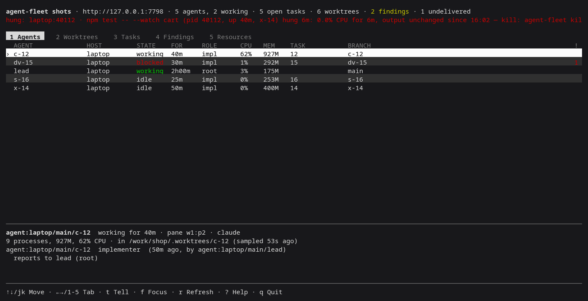
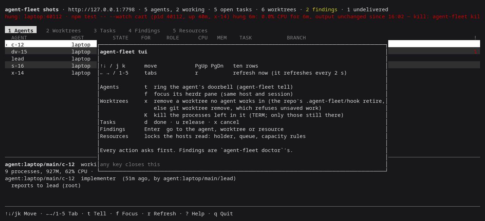

# agent-fleet

One event log for a fleet of coding agents. Every fact (an agent came up, a task was claimed, a
blocker was raised, a message was delivered) is a typed event. State is a fold over the events,
and every view is a function of the state.

It is for people who run several AI coding agents (Claude Code, Codex, Devin CLI and others) in
[herdr](https://herdr.dev) panes on one machine or a few. It tells you what every agent is doing,
gives tasks one owner each, delivers messages to agents and proves they arrived, starts agents on
GitHub issues, and finds hung, orphaned or forgotten work.

One Rust binary, no runtime. Linux and macOS.

**Status:** early (0.1.0). It runs a real fleet every day, but the CLI, the config and the
protocol can still change without notice.

## How it works

```
   agents ── fleet CLI ──┐                       ┌── agent-fleet host (machine A) ── herdr ── agent panes
                         ▼                       │
                 agent-fleet hub: event log ── SSE ────┼── agent-fleet host (machine B) ── herdr ── agent panes
                 (SQLite) + state                │
                                                 └── …
```

1. **Everything is an event.** An agent runs `agent-fleet task add`, `agent-fleet block` or `agent-fleet tell`. Each
   command sends one small JSON event to the hub, for example `blocker.raised`.
2. **The hub keeps the log.** It checks each event, appends it to a SQLite log, and folds the log
   into one state: who is up, who owns which task, what is blocked, which messages are not yet
   delivered. `agent-fleet ps` and `agent-fleet ui --text` print that state.
3. **One host agent per machine (and herdr session) watches herdr.** herdr pushes a status change when an agent turns
   idle, working or blocked. `agent-fleet host` turns each change into an event, so the hub always knows
   what every agent is doing, with no polling.
4. **Messages are doorbells.** `agent-fleet tell` writes a `msg.sent` event. The host agent on the
   recipient's machine types it into that agent's prompt. When it sees the agent start working,
   it writes `msg.delivered`. A message with no `delivered` is visibly lost, and the host retries
   it.
5. **Only one thing needs the hub's permission.** Claiming a task is exclusive: if someone already
   holds it, the hub answers 409. Everything else can wait. When the hub is down, the CLI keeps
   writes in a local spool and sends them later; replaying is safe because every event has a
   unique id.
6. **Every machine has a copy.** The host agent copies the whole log locally. When the hub is
   down, reads still work from that copy.

## Prerequisites

- **Rust** (stable, with `cargo`) to build. A host that runs `self-update` needs `cargo` too.
- **[herdr](https://herdr.dev)**: the agents run in its panes, and the host reads presence from it.
- **git**: worktrees for spawned agents, `self-update`.
- **[gh](https://cli.github.com)**, signed in: `agent-fleet spawn` reads issues with it, and
  `doctor` uses it to find open PRs no agent owns.
- **lsof**: the host's watch tick uses it to tell hung processes from busy ones.

## Install

Build from a clone and install the binary. `self-update` later pulls `main` in this same clone
and rebuilds, so keep the clone on `main`.

```sh
git clone https://github.com/kirmalyshev/agent-fleet
cd agent-fleet
cargo install --locked --path .        # puts agent-fleet in ~/.cargo/bin
agent-fleet --version                  # the crate version and the commit it was built from
```

## Quick start

On one machine, with herdr running:

```sh
agent-fleet hub &                      # first start writes a token file and the hub's URL
herdr session list                     # the name and socket of your herdr session
agent-fleet host --herdr-socket <socket> --session <name> &
```

Inside a herdr pane, `HERDR_SOCKET_PATH` and `HERDR_SESSION` are set, so there `agent-fleet host`
needs no flags. Now start an agent in a herdr pane (for example `claude`). The host reports it:

```sh
agent-fleet ps                         # agent:<host>/<session>/<agent name>  idle  claude …
```

An agent in a herdr pane runs the CLI as itself: its id is derived from herdr. Outside an agent
pane, say who you are with `--as` or `AGENT_FLEET_AGENT`:

```sh
export AGENT_FLEET_AGENT=agent:laptop/main/me
agent-fleet task add build-cache --title "Cache the build"     # claim; 409 if someone holds it
agent-fleet tell <agent> REVIEW task:default/build-cache "ready for a look"
agent-fleet ui --text                  # agents, tasks, blockers, asks, undelivered doorbells, hosts
agent-fleet ui                         # the same board in the browser, live
```

`tell` refuses an agent that is not up: nothing would deliver the message. When the hub is down,
ordinary writes go to a local spool and replay later; `task add` refuses instead, because only the
hub can decide who owns a task. Reads fall back to the host's replica.

To try it without touching a fleet you already run, give it its own data directory and port:

```sh
export AGENT_FLEET_HOME=$(mktemp -d) AGENT_FLEET_INSTANCE=try
agent-fleet hub --listen 127.0.0.1:7799 &       # later commands find this hub through AGENT_FLEET_HOME
```

An agent's CLI reads its pane shell's environment, not yours: export the same two variables in
that shell before you start the agent, or its commands go to your other fleet.

## Connect a repository

The host watches a repository's worktrees and runs spawns in it when you name its checkout:

```sh
agent-fleet host --herdr-socket <socket> --session <name> --repo owner/repo=/path/to/checkout
```

`--repo` is repeatable. A bare `--repo <dir>` derives the slug from the checkout's `origin` remote.
To add a repository, restart the host with one more `--repo`.

`agent-fleet spawn owner/repo#123` reads its rules from `<checkout>/.agent-fleet/fleet.toml`, or,
when the checkout has none, from `fleet.toml` and `brief.md` in your user config directory
(`~/.config/agent-fleet` on Linux, `AGENT_FLEET_CONFIG_DIR` overrides it). Start from
[docs/fleet.example.toml](docs/fleet.example.toml): profiles say which agent program to run and
how, rules route an issue to a profile and a host. `doctor`'s check for open PRs no agent owns
reads its repositories from the separate `[orphan_pr] repos` list. Try a route with
`agent-fleet spawn owner/repo#123 --dry-run`.

## Run the hub and host as services

`self-update` (and the host's own check every 5 minutes for a newer `origin/main`) rebuilds the
binary, and then the host **exits with status 75** so that its supervisor starts the new binary.
A host started by hand stays down after an update. The hub follows a replaced binary by itself
(same pid), so it needs a supervisor only to start at login and to recover from a crash.

**Linux, systemd `--user`.** `Restart=on-failure` restarts on any non-zero exit, 75 included.
Put both files in `~/.config/systemd/user/`. `%h` is your home directory; take the socket and
session from `herdr session list`.

```ini
# agent-fleet-hub.service
[Unit]
Description=agent-fleet hub

[Service]
ExecStart=%h/.cargo/bin/agent-fleet hub
Restart=on-failure
RestartSec=2

[Install]
WantedBy=default.target
```

```ini
# agent-fleet-host.service
[Unit]
Description=agent-fleet host
After=agent-fleet-hub.service

[Service]
ExecStart=%h/.cargo/bin/agent-fleet host --herdr-socket %h/.config/herdr/herdr.sock --session default
Restart=on-failure
RestartSec=2

[Install]
WantedBy=default.target
```

```sh
systemctl --user daemon-reload
systemctl --user enable --now agent-fleet-hub agent-fleet-host
loginctl enable-linger "$USER"         # keep them running when you are logged out
```

**macOS, launchd.** `KeepAlive` with `SuccessfulExit = false` restarts on a non-zero exit, 75
included. launchd does not expand `~` and its `PATH` is short, so give full paths and the `PATH`
that holds `cargo`, `git` and `gh`. Save as `~/Library/LaunchAgents/agent-fleet.host.plist`
(replace `/Users/you`, and take the socket and session from `herdr session list`), then `launchctl load ~/Library/LaunchAgents/agent-fleet.host.plist`. A hub
plist is the same with `hub` as the only argument and its own `Label`.

```xml
<?xml version="1.0" encoding="UTF-8"?>
<!DOCTYPE plist PUBLIC "-//Apple//DTD PLIST 1.0//EN" "http://www.apple.com/DTDs/PropertyList-1.0.dtd">
<plist version="1.0">
<dict>
  <key>Label</key>
  <string>agent-fleet.host</string>
  <key>ProgramArguments</key>
  <array>
    <string>/Users/you/.cargo/bin/agent-fleet</string>
    <string>host</string>
    <string>--herdr-socket</string>
    <string>/Users/you/.config/herdr/herdr.sock</string>
    <string>--session</string>
    <string>default</string>
  </array>
  <key>EnvironmentVariables</key>
  <dict>
    <key>PATH</key>
    <string>/Users/you/.cargo/bin:/opt/homebrew/bin:/usr/local/bin:/usr/bin:/bin:/usr/sbin:/sbin</string>
  </dict>
  <key>RunAtLoad</key>
  <true/>
  <key>KeepAlive</key>
  <dict>
    <key>SuccessfulExit</key>
    <false/>
  </dict>
  <key>StandardErrorPath</key>
  <string>/tmp/agent-fleet-host.log</string>
</dict>
</plist>
```

**No supervisor.** A shell loop restarts the host after an update and stops on any other exit:

```sh
while :; do agent-fleet host --herdr-socket <socket> --session <name>; [ $? = 75 ] || break; done
```

## Wire the agents

For Claude Code, add this to the project's `.claude/settings.json` (Devin CLI reads the same
file) or to `~/.claude/settings.json`:

```json
{
  "hooks": {
    "PreToolUse": [ { "matcher": "Bash|exec", "hooks": [ { "type": "command",
      "command": "command -v agent-fleet >/dev/null 2>&1 || exit 0; agent-fleet hook bash" } ] } ],
    "Stop":             [ { "hooks": [ { "type": "command", "command": "agent-fleet hook signal || true" } ] } ],
    "StopFailure":      [ { "hooks": [ { "type": "command", "command": "agent-fleet hook signal || true" } ] } ],
    "Notification":     [ { "hooks": [ { "type": "command", "command": "agent-fleet hook signal || true" } ] } ],
    "PreCompact":       [ { "hooks": [ { "type": "command", "command": "agent-fleet hook signal || true" } ] } ],
    "UserPromptSubmit": [ { "hooks": [ { "type": "command", "command": "agent-fleet hook signal || true" } ] } ]
  },
  "statusLine": { "type": "command", "command": "agent-fleet hook statusline" }
}
```

- `hook bash` refuses a raw `kill`, `pkill` or `killall` (use `agent-fleet kill`, which will not
  kill another agent's work) and an agent started outside herdr (use `agent-fleet spawn`).
- `hook signal` reports rate limits, permission prompts, questions and turn ends as
  `agent.signal`, so `ps` and `doctor` can say why an agent is stuck.
- `hook statusline` records Claude's rate limits for the host to publish as the agent's quota.
  To keep your own status line, wrap it: `agent-fleet hook statusline -- <your command>`.

Tell the fleet who coordinates. Run this in the coordinating agent's pane (or with `--as`):

```sh
agent-fleet role me root-coordinator
```

`agent-fleet tell coordinator …` then reaches it, and the host tells it about hung and orphaned
processes.
Other levels are `domain-lead`, `implementation-lead` and `implementer`, each with a `--lead`.

## Watch and steer the fleet: `agent-fleet tui`

`agent-fleet tui` shows the whole fleet on one screen and refreshes every 2 s. The top lines
count agents, tasks, worktrees, findings and undelivered messages; below them, in red, up to
three hung or orphaned processes, duplicate work or capacity breaches. Pick a tab with `1`–`5` or `←`/`→`, move with `↑`/`↓` or `j`/`k`, and read the selected
row's details in the bottom panel. The footer lists the keys of the current tab; `?` shows them
all, `q` quits.



| Tab | Shows | Keys |
|---|---|---|
| 1 Agents | State, time in it, role, CPU, memory, task, branch | `t` send a message (`tell`), `f` focus its herdr pane |
| 2 Worktrees | Branch, agent, unpushed commits, uncommitted files, what runs in it | `x` remove a worktree no agent works in, `K` kill the processes left in it |
| 3 Tasks | State, time in it, owner, open blockers, title | `d` done, `u` release, `x` cancel |
| 4 Findings | What `doctor` found: hung, orphaned, stuck or blocked work | `Enter` go to the agent, worktree or resource |
| 5 Resources | Locks the hosts report, who holds and who waits, capacity rules, quotas | |

Every action asks before it runs, and writes the same events as the CLI.




`agent-fleet ui` opens the same fleet in the browser: a tree of repositories, worktrees, agents
and tasks, and the Inbox where you answer agents' questions.

## Configuration

Flags or environment:

| Variable | Flag | What |
|---|---|---|
| `AGENT_FLEET_INSTANCE` | `--instance` | Which fleet (default `default`). |
| `AGENT_FLEET_HUB` | `--hub` | The hub's URL (default: the one this instance's hub wrote, else `http://127.0.0.1:7710`). |
| `AGENT_FLEET_HOME` | | The instance's data directory: hub log, token, spool, replica. |
| `AGENT_FLEET_TOKEN_FILE` | `--token-file` | The bearer token (default `<data dir>/token`). |
| `AGENT_FLEET_AGENT` | `--as` | Who is writing, `agent:<host>/<session>/<name>`. Derived inside an agent's herdr pane. |
| `AGENT_FLEET_PROJECT` | `--project` | Project for events that name none (default `default`). |
| `AGENT_FLEET_HOST` | `--host-name` | This machine's name in ids (default the hostname). |
| `AGENT_FLEET_CONFIG_DIR` | | Where the machine's `fleet.toml` and `brief.md` live. |
| `AGENT_FLEET_GH` | | The `gh` binary to run. |

The default data directory is the platform's (`~/.local/share/agent-fleet` on Linux).

**Instances.** One machine can run several fleets, one per project or product. Each instance has
its own directory (`instances/<name>` under the data directory), so its own hub, log, token,
spool and replica. Two hubs on one machine need two `--listen` ports. A host serves one instance
and one herdr session. `agent-fleet instances` lists them.

**Several machines.** Run one hub. Bind it to an address the other machines reach, plus
loopback (`--listen 127.0.0.1:7710 --listen <address>:7710`); it refuses `0.0.0.0`. On each other
machine run a host with `AGENT_FLEET_HUB=http://<address>:7710` and a token file: a copy of the
shared token, or better a token minted for that host (see [SECURITY.md](SECURITY.md)).

## Commands

From `agent-fleet --help`; every command has its own `--help`.

| Command | What |
|---|---|
| `hub` | Run the hub: the log, the fold and the sequencer, over HTTP + SSE |
| `mint-token` | Mint a token that may post only as `host:<name>` (and its agents) or `agent:<name>` (the agents on that host), into the hub's token table. Run it where the hub runs |
| `host` | Run the host agent for one herdr session: presence, disk, replica, doorbell delivery, and spawn requests for this host |
| `api` | Protocol metadata |
| `ps` | What every agent is doing |
| `self-update` | Every host that is up pulls `main` in the clone its binary was built from, rebuilds and restarts; prints the commit each one then runs. A dirty clone or one not on `main` refuses |
| `instances` | The agent-fleet instances on this machine and the hub each one uses |
| `tui` | The fleet on one screen, live: agents, worktrees, tasks, findings, and the actions on them |
| `task` | Tasks: `add` claims (exclusive), `done` finishes, `rm` cancels or releases |
| `dep` | Dependencies between tasks: <task> is blocked by <on> |
| `block` | Raise a blocker on a task. Prints the blocker id |
| `kill` | Signal processes safely: TERM, then KILL after --grace. Refuses agents, panes, the fleet's daemons and anything above them, your own ancestors and other agents' processes; kills only your own processes, orphans `doctor` proved, and processes the watch reported hung that a 5 s sample finds idle. A refusal kills nothing and is logged |
| `hook` | Hooks for agent harnesses |
| `resource` | Capacity rules for the resources hosts report |
| `unblock` | Resolve a blocker by its id |
| `ask` | Raise a question for an operator |
| `role` | Declare an agent's level of responsibility (root-coordinator, domain-lead, implementation-lead, implementer), or with no level show its role, its chain of leads and its direct reports |
| `spawn` | Spawn an agent on an issue, or with `--title` on work that has none: the project's `.agent-fleet/fleet.toml` picks the profile and host, the host agent runs it (worktree, env scrub, agent start, the brief) and answers `spawn.result`. Follows the hub until the result arrives (10 min) |
| `handoff` | Hand an agent's issue, branch and existing worktree to a new agent of `--to` (default: its profile's fallback), then close the replaced agent's pane and workspace |
| `tell` | Ring an agent's doorbell: `[agent-fleet <from>→<to>] TYPE ref: text (event <id>)` |
| `stats` | Numbers about the fleet: doorbell latency and loss, event lag, host and hub vitals |
| `proc` | What the log says of a process on this host: `hung`, `orphan`, `waiting` (in a lock's queue), `no report` (not hung, or not watched), or `gone` |
| `doctor` | What needs a look: stale, hung or heavy agents, duplicate work, forgotten worktrees, unpushed commits |
| `bench` | Load-test a throwaway in-process hub: post latency, throughput, follower lag, 409 races |
| `state` | The folded state |
| `ui` | The board in the browser (live, every status), or with --text here |

## Security

The hub needs a bearer token for every request, binds a specific address, and has no TLS.
Agents run as the same Unix user as their host and can read its token. `agent-fleet kill` refuses
other agents' processes and checks every hung report against the live process before it signals.
[SECURITY.md](SECURITY.md) has the trust model and how to report a vulnerability.

## More

- [docs/PROTOCOL.md](docs/PROTOCOL.md): the spec. Events, the rules the hub enforces, the HTTP
  API, doorbells, presence, spawning, self-update, killing processes.
- [docs/](docs/README.md): the other documents.
- [CONTRIBUTING.md](CONTRIBUTING.md): build, test, the code map and the conventions.

MIT licensed. See [LICENSE](LICENSE).
